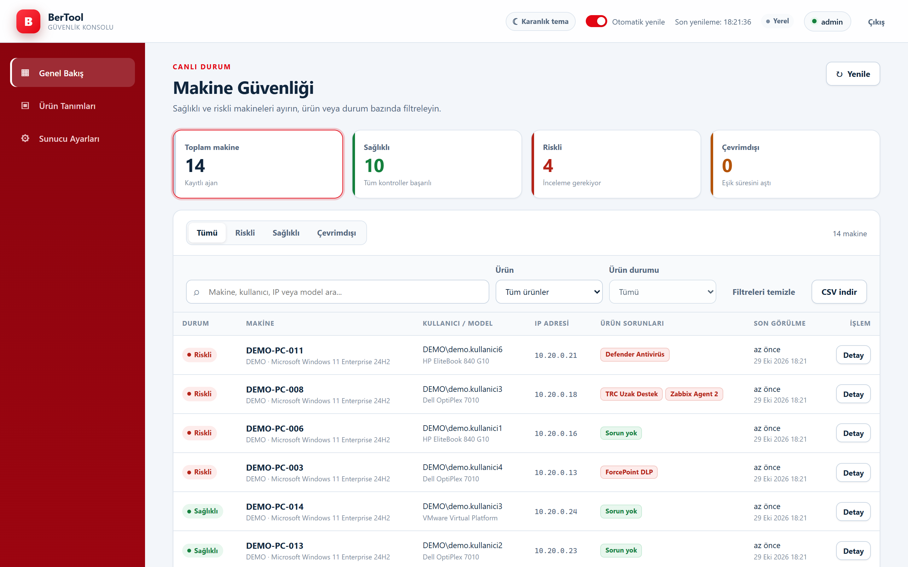
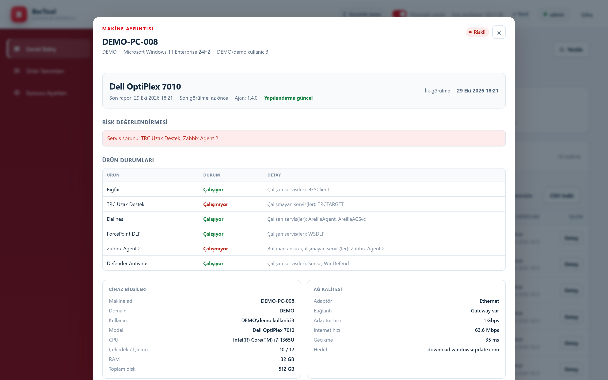
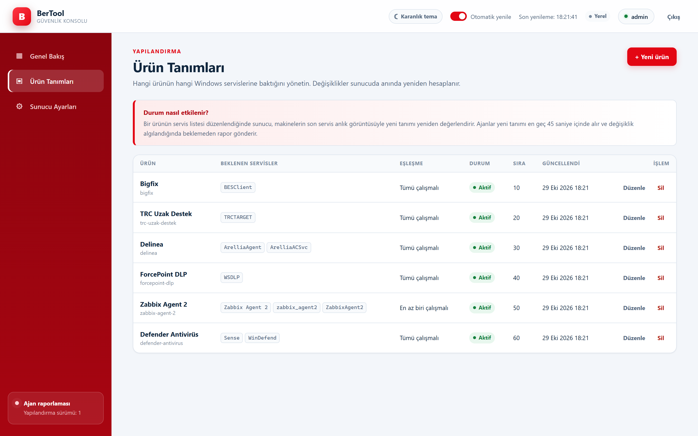
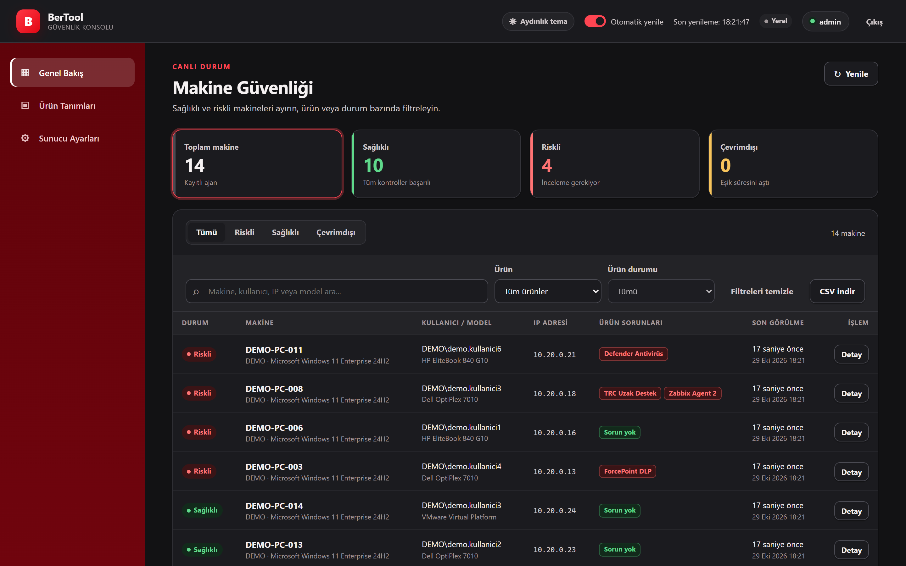
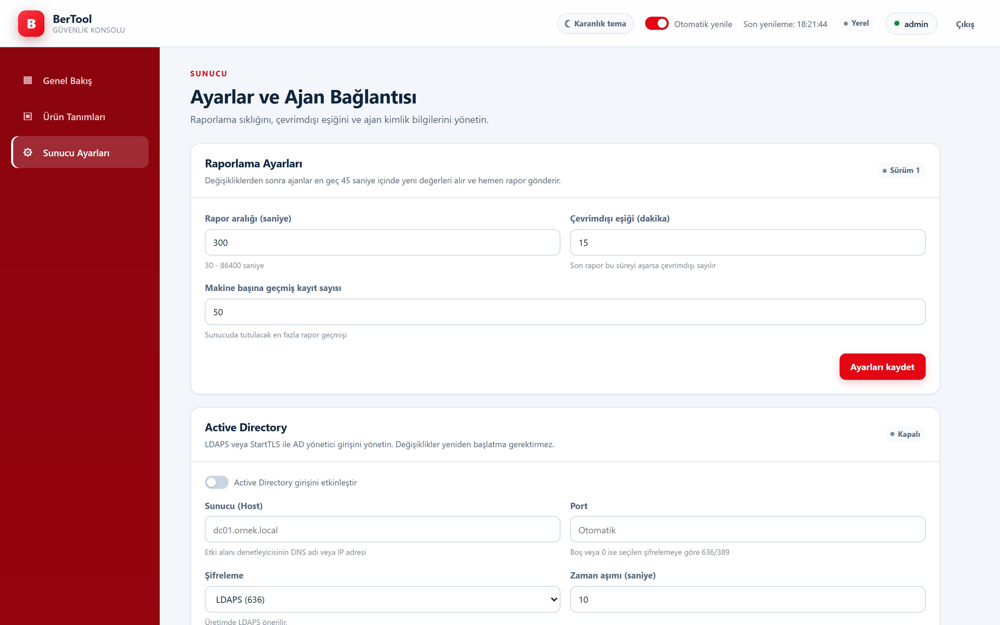

<p align="center"></p>

<h1 align="center">BerTool</h1>

<p align="center"><strong>Windows makinelerde güvenlik ajanları, servisler ve BitLocker için tray ajanı ve merkezi yönetim konsolu.</strong></p>

<p align="center">
<a href="https://berkayatag.github.io/BerTool/">Tanıtım sayfası</a> ·
<a href="https://github.com/BerkayAtag/BerTool/releases/tag/v1.4.0">İndir (1.4.0)</a> ·
<a href="#hızlı-kurulum">Hızlı kurulum</a> ·
<a href="CHANGELOG.md">Değişiklikler</a>
</p>

<p align="center">1.4.0 · Windows x64 · .NET 8 (self-contained) · MIT · Berkay Atağ</p>



BerTool iki bileşenden oluşur:

- **BerTool Tray Ajanı:** Windows makinelerde servis, BitLocker, donanım ve ağ bilgilerini toplar; sonucu tray simgesi ve açılır pencerede gösterir, merkezi sunucuya raporlar.
- **BerTool Sunucusu + Yönetim Konsolu:** Makinelerden gelen raporları saklar, sağlıklı/riskli/çevrimdışı makineleri listeler, ürün-servis tanımlarını ve raporlama ayarlarını yönetir.

Tüm arayüz, log ve dokümantasyon Türkçedir.

## Hızlı kurulum

[Releases](https://github.com/BerkayAtag/BerTool/releases/tag/v1.4.0) sayfasından iki kurulum dosyasını indirin. Her ikisi de tıkla-kur şeklindedir: çift tıklayın, **Kur**'a basın, **Bitir**. Hedef makinede .NET gerekmez.

| Dosya | Ne kurar | Yetki |
| --- | --- | --- |
| `BerTool.Server.Setup-1.4.0.exe` | Sunucu ve yönetim konsolu (`http://127.0.0.1:5081`) | Standart kullanıcı |
| `BerTool.Client.Setup-1.4.0.exe` | Windows tray ajanı | Yönetici |
| `SHA256SUMS.txt` | Dosya bütünlüğü özetleri | — |

1. **Sunucu:** kurulum bitince konsol tarayıcıda açılır. Bitiş ekranındaki *İlk giriş bilgilerini göster* seçeneği yönetici şifresini ve ajan API anahtarını içeren `bootstrap-credentials.txt` dosyasını açar.
2. **İstemci:** sunucu adresi ve anahtarla sessiz dağıtın:

   ```cmd
   BerTool.Client.Setup-1.4.0.exe /VERYSILENT /SUPPRESSMSGBOXES /NORESTART /SERVERURL="https://bertool.example.com" /APIKEY="AJAN-API-ANAHTARI"
   ```

   Parametresiz çift tıklandığında ajan yerel modda çalışır (yalnızca tray durumu).

Programlar ve Özellikler (`appwiz.cpl`) içinde her iki ürün de kırmızı BerTool simgesi ve **Berkay Atağ** yayıncı adıyla görünür. Yayınlanan 1.4.0 kurulum dosyaları henüz Authenticode ile imzalı değildir; Windows SmartScreen uyarısında *Ek bilgi → Yine de çalıştır* seçin. Derleme hattı imzalamaya hazırdır; ayrıntılar [Kod imzalama](#kod-imzalama) bölümündedir.

## Ekranlar

| Makine detayı | Ürün tanımları |
| --- | --- |
|  |  |
| **Koyu tema** | **Sunucu ayarları ve Active Directory** |
|  |  |

Ekran görüntülerindeki makineler ve kullanıcılar sentetik test verisidir.

## 1.4.0 ile gelenler

- **Kırmızı marka simgesi:** çok boyutlu (16–256 px, 32 bit) yeni ICO; uygulama, kurulum sihirbazı, Başlat menüsü ve `appwiz.cpl` simgesi.
- **Tıkla-kur setup:** klasör/hoş geldiniz sayfaları kaldırıldı; tek *Kur* onayı. Sunucu kurulumu, sunucu dinlemeye başlayana kadar bekler ve ilk giriş bilgilerini bitiş ekranından gösterebilir.
- **BitLocker düzeltmesi:** WMI `GetEncryptionMethod` çağrısı kısmi nesne nedeniyle her yenilemede başarısız oluyordu; tam nesneyle sorgulanıyor. Standart kullanıcıda 45 saniyede bir yığın izli “Access denied” logu yerine tek bilgi satırı yazılıyor.
- **Sunucu tarafı BitLocker değerlendirmesi:** XTS-AES-256 dışı şifreleme, ajan “sağlıklı” bildirse bile sunucuda riskli sayılır.
- **Güvenlik:** ajan API anahtarı istek gövdesi okunmadan doğrulanır; Data Protection anahtarları Windows'ta DPAPI ile şifrelenir; sunucunun varsayılan adresi `127.0.0.1`.
- **Hata düzeltmeleri:** aynı servisin ürün detayında tekrar listelenmesi, tray'de ilk veri gelmeden “Sunucuya Raporla” ile sahte risk raporu gönderilmesi, varsayılan ürünlerde boş “Güncellendi” sütunu, makine detayındaki hizalama.

Tüm liste: [CHANGELOG.md](CHANGELOG.md).

## Özellikler

- System tray'de yeşil (sağlıklı) veya kırmızı (riskli) durum ikonu
- 45 saniyede bir yerel durum yenilemesi
- Merkezi sunucuya periyodik raporlama (varsayılan 300 saniye)
- Sunucudan dinamik ürün/servis tanımı alma ve çevrimdışı önbellek kullanımı
- Sağlıklı, riskli ve çevrimdışı makineleri ayrı sekmelerde görme
- Makine adı, kullanıcı, IP, model, ürün ve risk nedeni ile arama
- Ürün ve ürün durumu bazında filtreleme
- Makine detayında tüm Windows servis anlık görüntüsü ve servis arama
- Ürün tanımı ekleme, düzenleme, silme (hangi ürünün hangi servislere baktığı)
- Ürün tanımı değiştiğinde mevcut raporların anında yeniden değerlendirilmesi
- Rapor aralığı, çevrimdışı eşiği ve geçmiş limiti ayarları
- CSV dışa aktarma (UTF-8 BOM, Excel uyumlu)
- Yönetici oturumu, şifre değiştirme ve ajan API anahtarı yenileme
- Active Directory / LDAP ile yönetici girişi, konsoldan düzenlenebilen AD ayarları, iç içe grup yetkilendirmesi ve yerel yedek giriş
- Kırmızı-beyaz varsayılan tema, isteğe bağlı karanlık tema
- Ajan ayarlarını kurulum sırasında verme veya merkezi olarak yapılandırma
- Tek örnek çalışma, BitLocker cache görevi ve sessiz kurulum desteği

## Mimari

```text
Windows istemci                                    Merkezi sunucu
┌─────────────────────────────┐                   ┌──────────────────────────────┐
│ BerTool.TrayAgent (WinForms)│  HTTPS + API key  │ BerTool.Server (ASP.NET Core)│
│  - ServiceHealthChecker     │ ────────────────► │  - /api/agent/config         │
│  - BitLockerChecker         │ ◄──────────────── │  - /api/agent/report         │
│  - SystemInfoProvider       │   ürün tanımları  │  - JSON veri deposu          │
│  - NetworkQualityChecker    │                   │  - Yönetim API'si            │
│  - Reporting                │                   │  - wwwroot yönetim konsolu   │
└─────────────────────────────┘                   └──────────────────────────────┘
```

- **Ortak katman:** `BerTool.Shared` — API sözleşmeleri, varsayılan ürün kataloğu ve ürün/servis değerlendirme kuralları. Ajan ve sunucu aynı değerlendirme kodunu kullanır.
- **Sunucu:** ASP.NET Core minimal API + statik HTML/CSS/JS konsol. Harici NuGet paketi veya CDN bağımlılığı yoktur.
- **Veri:** JSON dosyaları, atomik yazma. Orta ölçekli filo için uygundur; çok yüksek yazma hacminde SQL veritabanına geçiş önerilir.
- **Kimlik doğrulama:** Yönetici için cookie oturumu + PBKDF2-SHA256 şifre özeti; konsoldan yönetilen isteğe bağlı Active Directory/LDAP doğrulaması ve iç içe grup yetkilendirmesi; ajan için `X-BerTool-Api-Key` başlığı ve yalnızca SHA-256 özeti saklanır.

## Proje Yapısı

```text
BerTool.TrayAgent.sln
LICENSE               MIT
build-installer.cmd
src/
  BerTool.Shared/
    Contracts/
      AgentContracts.cs
      AdminContracts.cs
    Products/
      DefaultProductCatalog.cs
      ProductHealthEvaluator.cs
  BerTool.Server/
    Program.cs
    appsettings.json
    Configuration/
      ServerOptions.cs
      AdOptions.cs
    Storage/
      ServerStore.cs
      StoredModels.cs
    Endpoints/
      AgentEndpoints.cs
      AdminEndpoints.cs
      ReportSanitizer.cs
      CsvFormatter.cs
    Security/
      PasswordHasher.cs
      LdapFilter.cs
      AdAuthenticationService.cs
      LoginThrottle.cs
      RequestSecurityMiddleware.cs
    wwwroot/
      index.html
      styles.css
      app.js
      theme.js
  BerTool.TrayAgent/
    Program.cs
    TrayAppContext.cs
    MainPopupForm.cs
    Models/
    Services/
      ServiceHealthChecker.cs
      BitLockerChecker.cs
      SystemInfoProvider.cs
      NetworkQualityChecker.cs
      TrayStatusEvaluator.cs
    Reporting/
      AgentSettingsProvider.cs
      AgentApiClient.cs
      AgentConfigurationProvider.cs
      AgentReportBuilder.cs
      AgentReportingService.cs
      MachineIdentityProvider.cs
      ReportingJson.cs
    Logging/Logger.cs
    Utilities/IconFactory.cs
tools/
  BerTool.IconGenerator/
  Package-BerToolServer.ps1
  Sign-BerTool.ps1      İsteğe bağlı Authenticode imzalama
tests/
  BerTool.Tests/
  Smoke.Installers.ps1
docs/
  index.html          Tanıtım sayfası (GitHub Pages)
  screenshots/        Güncel konsol ekran görüntüleri
  assets/             Logo ve kurulum görselleri
.github/workflows/
  validate.yml        Derleme, test, setup üretimi ve Windows kurulum testi
Installer/
  BerToolSetup.iss
  BerToolServerSetup.iss
  ServerSupport/
    start-server.ps1
    stop-server.ps1
```

## Çalışma Mantığı

### Ajan

Uygulama açıldığında tray ikonu görünür ve ilk kontrol hemen başlar; ardından her **45 saniyede bir** yerel durum yenilenir. Aynı anda birden fazla yenileme çalıştırılmaz.

Bir yenileme sırasında:

1. Sunucudan alınan (veya önbellekteki/varsayılan) ürün tanımlarına göre Windows servisleri okunur.
2. Cihaz bilgileri toplanır.
3. Ağ kalitesi ölçülür.
4. BitLocker durumu okunur (VMware istisnası hariç).
5. Sonuç `HealthStatus` modelinde birleştirilir, tray/popup güncellenir.
6. Raporlama zamanı geldiyse tüm veri sunucuya gönderilir.

Sunucu yapılandırması **45 saniyede bir** yenilenir. Sunucuya ulaşılamazsa son başarılı yapılandırma `%LOCALAPPDATA%\BerTool\agent-config-cache.json` dosyasından yüklenir; o da yoksa yerleşik varsayılan ürünler kullanılır. Başarısız yapılandırma denemeleri 2 dakika, kimlik doğrulama hataları 10 dakika sonra tekrar denenir.

Rapor gönderimi sunucunun döndürdüğü `nextReportAfterSeconds` değerine göre planlanır. Başarısız gönderimler 2 dakika sonra, kimlik doğrulama hataları 10 dakika sonra tekrar denenir. Ajan, rapor yanıtındaki yapılandırma sürümü kendi sürümünden farklıysa ürün tanımlarını hemen çekmeyi dener.

Konsoldan rapor aralığı, çevrimdışı eşiği veya ürün tanımı değiştirildiğinde ajan bunu en geç **45 saniye** içinde algılar. Yapılandırma imzası değiştiyse planlı rapor zamanı beklenmez; ajan yeni tanımlarla **hemen rapor gönderir**. Böylece `ConfigVersion` ve ayarların etkisi konsolda kısa sürede doğrulanabilir.

### Sunucu

- İlk çalıştırmada `data/server.json` ve varsayılan ürün tanımları oluşturulur.
- Yönetici şifresi veya ajan API anahtarı yapılandırmada verilmemişse güçlü rastgele değerler üretilir ve `data/bootstrap-credentials.txt` dosyasına yazılır.
- Her rapor `data/machines/<makine-kimliği>.json` dosyasına kaydedilir; geçmiş limiti ayarlanabilir.
- Ürün tanımı veya ayar değiştiğinde `ConfigVersion` artırılır. Dashboard, kayıtlı servis anlık görüntülerini **güncel tanımlarla hemen yeniden değerlendirir**; ajanlar değişikliği en geç 45 saniye içinde alır ve hemen rapor gönderir.
- Ayar değerleri gerçekten değişmediyse `ConfigVersion` artırılmaz; gereksiz ajan yenilemeleri önlenir.
- Geçmiş limiti düşürüldüğünde mevcut makine geçmişleri **anında** yeni sınıra göre kırpılır.
- Makine durumu: son raporu çevrimdışı eşiğini aşmışsa **Çevrimdışı**, değilse güncel ürün sonuçlarına ve hizmet dışı risk nedenlerine göre **Sağlıklı / Riskli**.

### Sağlık Kuralları

Cihaz **Sağlıklı** kabul edilir ancak ve ancak:

- Etkin tüm ürün tanımlarındaki servis kontrolleri başarılıysa,
- BitLocker uygulanabilir bir cihazsa tüm sabit disklerde yöntem `XTS-AES-256` ise.

Aksi halde **Riskli** olur. Ağ hızı ve gecikme bilgilendirme amaçlıdır; genel durumu etkilemez.

Servis adları ve görünen adlar büyük/küçük harf duyarsız karşılaştırılır; noktalama ve boşluk farkları normalize edilir. Ürün tanımındaki eşleşme modu **Tümü çalışmalı** veya **En az biri çalışmalı** olabilir. Servis bulunamazsa **Bulunamadı**, bulunup çalışmıyorsa **Çalışmıyor** gösterilir.

#### Varsayılan Ürünler

| Ürün | Beklenen servis(ler) | Eşleşme |
| --- | --- | --- |
| Bigfix | `BESClient` | Tümü çalışmalı |
| TRC Uzak Destek | `TRCTARGET` | Tümü çalışmalı |
| Delinea | `ArelliaAgent`, `ArelliaACSvc` | Tümü çalışmalı |
| ForcePoint DLP | `WSDLP` | Tümü çalışmalı |
| Zabbix Agent 2 | `Zabbix Agent 2`, `zabbix_agent2`, `ZabbixAgent2` | En az biri çalışmalı |
| Defender Antivirüs | `Sense`, `WinDefend` | Tümü çalışmalı |

Bu liste yönetim konsolundaki **Ürün Tanımları** ekranından değiştirilebilir. Örneğin Bigfix'in baktığı servis `BESClient` yerine başka bir servis adı olarak güncellenebilir.

### BitLocker

- Yalnızca `DriveType.Fixed` sürücüler kontrol edilir.
- Önce WMI (`Win32_EncryptableVolume`) okunur.
- WMI `N/A` / `Unknown` dönerse ve süreç yönetici ise `manage-bde -status` fallback'i kullanılır (5 saniye zaman aşımı).
- Standart kullanıcı oturumunda `manage-bde` çalıştırılmaz; `%PROGRAMDATA%\BerTool\bitlocker-cache.json` cache'i kullanılır.
- Tek sağlıklı yöntem `XTS-AES-256`'dır. `AES-CBC-*`, donanım şifreleme, `N/A` ve `Unknown` risklidir.
- Model `VMware` içeriyorsa BitLocker kontrolü devre dışıdır.

Cache şu durumlarda güncellenir:

- Kurulum sırasında (yönetici),
- `BerTool BitLocker Cache` zamanlanmış görevi ile kullanıcı oturum açtığında (SYSTEM),
- Elle `BerTool.TrayAgent.exe --update-bitlocker-cache` çalıştırıldığında.

Cache yazımı geçici dosya + atomik taşıma ile yapılır. Klasör izinleri SYSTEM/Administrators tam, standart kullanıcılar okuyabilir olacak şekilde sıkılaştırılır.

### Ağ Kalitesi

- Gateway'i olan, loopback olmayan ve IPv4 adresi bulunan adaptörler tercih edilir.
- **Network Hızı** adaptör link speed değeridir; internet gerektirmez.
- **İnternet Hızı** `download.windowsupdate.com` üzerinden ilk 16 MB indirilerek ölçülür. Önce HTTP, sonra HTTPS denenir; her deneme 15 saniye zaman aşımına sahiptir.
- Başarılı ölçüm **10 dakika** cache'lenir. Başarısız ölçüm cache'lenmez.
- Renk eşikleri: `> 10 Mbps` iyi, `5-10 Mbps` uyarı, `< 5 Mbps` kritik.

## Setup Dosyalarını Üretme

Proje kökünde cmd açıp tek komut çalıştırın:

```cmd
build-setups.cmd
```

Bu komut tüm derlemeyi yapar ve teslim dosyalarını `dist\<sürüm>\` altında toplar:

- `BerTool.Client.Setup-<sürüm>.exe` — Windows istemci/tray ajanı kurulumu
- `BerTool.Server.Setup-<sürüm>.exe` — sunucu ve yönetim konsolu kurulumu
- `KURULUM.txt` — istemci/sunucu kurulum yönergesi
- `SHA256SUMS.txt` — dosya bütünlüğü özetleri

Her iki taraf da Inno Setup ile **EXE** kurulum dosyası olarak üretilir. Sunucu kurulumu kullanıcı bazlıdır; yönetici yetkisi gerektirmez ve mevcut veriyi korur. Ayrıntılı adımlar `KURULUM.txt` ve bu belgede yer alır.

## Sunucu Kurulumu

### Gereksinimler

- Windows / Linux (x64) veya .NET 8 destekleyen başka bir platform
- Derleme için .NET 8 SDK
- Üretimde HTTPS sertifikası ve güvenlik duvarı

### Paketleme

Tüm çözümü ve sunucu paketini birlikte üretmek için:

```cmd
build-installer.cmd --with-server
```

Bu komut:

1. Marka ikonunu üretir.
2. Tray ajanını self-contained tek dosya olarak publish eder.
3. Sunucuyu `artifacts\BerTool.Server` altına self-contained olarak publish eder.
4. `Installer\BerToolSetup.exe` istemci kurulum dosyasını derler.
5. `Installer\BerToolServerSetup.exe` sunucu kurulum dosyasını derler.

Sunucuyu tek başına publish etmek için:

```cmd
dotnet publish "src\BerTool.Server\BerTool.Server.csproj" -c Release -r win-x64 --self-contained true -p:PublishSingleFile=false -p:DebugType=None -p:DebugSymbols=false -o "artifacts\BerTool.Server"
```

### Sunucu Setup Dosyası

`build-setups.cmd` çıktısındaki `BerTool.Server.Setup-<sürüm>.exe` dosyasını sunucuda çalıştırın. Kurulum:

- Uygulamayı `%LOCALAPPDATA%\BerToolServer\app` altına kurar.
- Veriyi `%LOCALAPPDATA%\BerToolServer\data` altında tutar; mevcut veriyi silmez.
- Varsayılan olarak yalnızca `http://127.0.0.1:5081` adresini dinler.
- Sunucuyu kurulum sonunda başlatır ve oturum açılışında otomatik başlatır.
- Başlat menüsüne konsol, başlat/durdur ve veri klasörü kısayolları ekler.
- Kaldırma sırasında `appsettings.json`, `appsettings.Production.json`, `.bak`, veri dizini ve `server.json` içindeki ayarlar korunur; yapılandırma dosyaları `%LOCALAPPDATA%\BerToolServer\config-backup` altına yedeklenir ve yeniden kurulumda geri yüklenir.

Kurulum parametreleri:

```cmd
BerTool.Server.Setup-1.4.0.exe /PORT=5081 /BIND=127.0.0.1
BerTool.Server.Setup-1.4.0.exe /URLS="https://0.0.0.0:5443"
BerTool.Server.Setup-1.4.0.exe /DATADIR="C:\BerToolData"
BerTool.Server.Setup-1.4.0.exe /FORCECONFIG=1
BerTool.Server.Setup-1.4.0.exe /SILENT
```

`/FORCECONFIG=1` verilmezse mevcut `appsettings.json`,
`appsettings.Production.json` ve veri dizini korunur. Kurulum parametreleriyle
adres veya veri dizini değiştirmek için `appsettings.Production.json` dosyasını
düzenleyin ya da `/FORCECONFIG=1` ile yeniden çalıştırın. AD ayarları konsoldan
yönetildiği için güncelleme sırasında ayrıca parametre gerekmez.

Eski portable (ZIP) kurulumdan geçişte veri dizinini açıkça verin:

```cmd
BerTool.Server.Setup-1.4.0.exe /DATADIR="C:\Eski\Sunucu\data" /FORCECONFIG=1
```

Yerel olmayan bir `BIND` adresi verildiğinde kurulum varsayılan olarak
`https://` üretir. Sertifikayı `appsettings.Production.json` içindeki
`Kestrel:Certificates:Default` bölümünde tanımlayın veya güvenilir bir ters
proxy kullanın. Sessiz kurulumda yerel ağa açık `http://` adresi reddedilir;
etkileşimli kurulumda yalnızca açık onayla devam edilebilir. Yerel ağda
güvenlik duvarında yalnızca HTTPS portunu açın; HTTP portunu (varsayılan 5080)
dışarı açmayın.

Sunucu kaldırılırken çalışan işlem durdurulur, uygulama dosyaları ve kısayollar
temizlenir. Sunucunun oturum açılış kısayolu (`BerTool Sunucu.lnk`) kaldırılır;
istemci kısayolları korunur. `appsettings.json`, `appsettings.Production.json` ve `.bak`
dosyaları `%LOCALAPPDATA%\BerToolServer\config-backup` altına yedeklenir;
yeniden kurulumda bu yedekler geri yüklenir. Yedek geri yüklenemezse kurulum
sessizce varsayılan ayarlara dönmez; hata vererek durur ve yedek/veri
dosyalarını korur. `data` ve `logs` klasörleri silinmez. Veriyi tamamen silmek
için kaldırma sonrasında `%LOCALAPPDATA%\BerToolServer` klasörünü elle silin.

### İlk Çalıştırma

Setup dosyasını çalıştırdıktan sonra konsol otomatik açılır:

- Konsol: `http://127.0.0.1:5081/`
- Sağlık kontrolü: `http://127.0.0.1:5081/healthz`
- İlk yönetici kullanıcı adı varsayılan olarak `admin`'dir.
- Üretilen şifre ve ajan API anahtarı `%LOCALAPPDATA%\BerToolServer\data\bootstrap-credentials.txt` dosyasındadır. İlk girişten sonra şifreyi değiştirin, bilgileri güvenli yere taşıyın ve bu dosyayı silin.

Geliştirme sırasında uygulamayı doğrudan çalıştırmak için:

```powershell
$env:BerTool__DataDirectory = "$env:TEMP\BerTool.ServerTest"
dotnet run --project "src\BerTool.Server\BerTool.Server.csproj" --urls "http://127.0.0.1:5181"
```

HTTPS olmadan yalnızca localhost/test ortamında çalıştırın. Ajan API anahtarı ve yönetici oturumu LAN üzerinden açık metin taşınmamalıdır. Üretim ve LAN kurulumlarında HTTPS kullanın.

### Yapılandırma

`appsettings.json` veya ortam değişkenleri kullanılabilir. Ortam değişkenlerinde iki alt çizgi (`__`) ayırıcıdır.

| Ayar | Ortam değişkeni | Varsayılan | Açıklama |
| --- | --- | --- | --- |
| `Urls` | `ASPNETCORE_URLS` | `http://127.0.0.1:5080` | Dinlenecek adres(ler); setup `127.0.0.1:5081` yazar |
| `BerTool:DataDirectory` | `BerTool__DataDirectory` | `data` | Veri klasörü (mutlak yol önerilir) |
| `BerTool:SessionHours` | `BerTool__SessionHours` | `12` | Yönetici oturum süresi (1-72 saat) |
| `BerTool:AdminUsername` | `BerTool__AdminUsername` | `admin` | Yalnızca ilk kurulumda kullanılır |
| `BerTool:AdminPassword` | `BerTool__AdminPassword` | rastgele | Yalnızca ilk kurulumda kullanılır |
| `BerTool:AgentApiKey` | `BerTool__AgentApiKey` | rastgele | Yalnızca ilk kurulumda kullanılır |
| `BerTool:AllowedOrigins:0` | `BerTool__AllowedOrigins__0` | boş | Ek izinli Origin adresleri |
| `BerTool:TrustedProxies:0` | `BerTool__TrustedProxies__0` | boş | Ters proxy IP'leri |
| `BerTool:Ad:Enabled` | `BerTool__Ad__Enabled` | `false` | Active Directory girişini etkinleştirir |
| `BerTool:Ad:Host` | `BerTool__Ad__Host` | boş | Etki alanı denetleyicisi |
| `BerTool:Ad:Port` | `BerTool__Ad__Port` | `0` | `0` ise LDAPS 636, LDAP 389 |
| `BerTool:Ad:UseSsl` | `BerTool__Ad__UseSsl` | `true` | LDAPS kullanımı |
| `BerTool:Ad:UseStartTls` | `BerTool__Ad__UseStartTls` | `false` | StartTLS kullanımı |
| `BerTool:Ad:AllowInsecureLdap` | `BerTool__Ad__AllowInsecureLdap` | `false` | Şifresiz LDAP'a izin verir (yalnızca test) |
| `BerTool:Ad:BaseDn` | `BerTool__Ad__BaseDn` | boş | Arama kökü, ör. `DC=ornek,DC=local` |
| `BerTool:Ad:BindDn` | `BerTool__Ad__BindDn` | boş | Hizmet hesabı DN'i |
| `BerTool:Ad:BindPassword` | `BerTool__Ad__BindPassword` | boş | Hizmet hesabı şifresi |
| `BerTool:Ad:AdminGroup` | `BerTool__Ad__AdminGroup` | boş | Yönetici grubu DN'i veya adı |
| `BerTool:Ad:AllowLocalFallback` | `BerTool__Ad__AllowLocalFallback` | `true` | AD yokken yerel girişe izin verir |
| `BerTool:Ad:IgnoreCertificateErrors` | `BerTool__Ad__IgnoreCertificateErrors` | `false` | Yalnızca test için sertifika doğrulamasını kapatır |
| `BerTool:Ad:TimeoutSeconds` | `BerTool__Ad__TimeoutSeconds` | `10` | LDAP işlem zaman aşımı (3-60 sn) |

`AdminPassword` veya `AgentApiKey` verildiğinde bunlar yalnızca ilk kurulumda kullanılır; sonraki değişiklikler için konsoldaki şifre/anahtar ekranlarını kullanın.

AD ayarları için `appsettings.json` yalnızca başlangıç değerlerini sağlar.
Konsoldan kaydedilen ayarlar veri dizinindeki `server.json` dosyasına yazılır ve
sonraki açılışlarda dosya ayarları önceliklidir. Hizmet hesabı parolası
`keys/` altındaki ASP.NET Core Data Protection anahtarlarıyla şifrelenir.

### Tema

Konsol varsayılan olarak kırmızı-beyaz renk paletiyle açılır.
Giriş ekranındaki veya üst çubuktaki tema düğmesiyle karanlık temaya geçilebilir.
Seçim tarayıcının `localStorage` alanında saklanır; sunucu tarafında ayar
gerektirmez. Kullanıcı bazlı bir tercihtir ve diğer kullanıcıları etkilemez.

### TLS ve Ters Proxy

Önerilen yöntem TLS'i doğrudan Kestrel'de sonlandırmaktır (yukarıdaki örnek).

Ters proxy (nginx, IIS, Caddy vb.) kullanılacaksa:

- Proxy'den uygulamaya yalnızca güvenli ağdan erişim verin.
- Proxy IP'sini `BerTool__TrustedProxies__0` olarak tanımlayın; uygulama `X-Forwarded-For`, `X-Forwarded-Proto` ve `X-Forwarded-Host` başlıklarını yalnızca bu IP'den kabul eder.
- Proxy public adresi `Origin` başlığında farklı görünüyorsa `BerTool__AllowedOrigins__0=https://bertool.example.com` ekleyin.
- Forwarded headers sayesinde oturum çerezi HTTPS'te `Secure` bayrağıyla gönderilir.

### Active Directory / LDAP Entegrasyonu

AD entegrasyonu isteğe bağlıdır ve varsayılan olarak kapalıdır. Etkinleştirildiğinde yönetici girişi şu sırayla denenir:

1. Kullanıcı, hizmet hesabıyla dizinde aranır (`sAMAccountName`, gerekiyorsa `userPrincipalName`; `DOMAIN\kullanici` biçimi de desteklenir).
2. Devre dışı hesaplar reddedilir.
3. Kullanıcının parolası, kendi kimliğiyle LDAP bind yapılarak doğrulanır.
4. Kullanıcının yönetici grubunda olup olmadığı **iç içe grup üyeliği** dahil (`LDAP_MATCHING_RULE_IN_CHAIN`) kontrol edilir.
5. AD doğrulaması başarısızsa ve `AllowLocalFallback` açıksa yerel yönetici hesabı denenir.

AD ayarları yönetim konsolundaki **Ayarlar → Active Directory** bölümünden düzenlenebilir. Kaydedilen ayarlar veri dizinindeki `server.json` dosyasına yazılır; değişiklikler yeniden başlatma gerektirmeden bir sonraki girişten itibaren geçerlidir. Konsolda yalnızca LDAPS ve StartTLS seçenekleri sunulur; şifresiz LDAP ve sertifika doğrulamasını kapatma yalnızca `appsettings.json` üzerinden açılabilir ve konsolda güvenlik uyarısı olarak gösterilir.

Konsoldaki form:

- **Bağlantıyı test et:** Kaydedilmemiş form değerleriyle hizmet hesabı bind'ini, `BaseDn` erişimini ve yönetici grubunu doğrular.
- **AD ayarlarını kaydet:** Ayarları doğrular ve anında etkinleştirir. Hatalı yapılandırma kaydedilmez.
- **Hizmet hesabı parolası:** İstemciye hiçbir zaman geri gönderilmez. Alan boş bırakılırsa kayıtlı parola korunur; yeni parola girilirse Data Protection ile şifrelenerek saklanır.
- **Yerel yedek giriş:** AD kesintisinde yerel yönetici hesabıyla girişe izin verir. Kapalıyken yalnızca AD kullanılabilir.

`appsettings.json` yalnızca başlangıç değerlerini sağlar. Veri dizininde daha önce kaydedilmiş AD ayarı varsa dosya değerleri ezilmez; ilk geçişte `appsettings.json` değerleri bir kez okunur.

Örnek `appsettings.json`:

```json
{
  "BerTool": {
    "Ad": {
      "Enabled": true,
      "Host": "dc01.ornek.local",
      "Port": 636,
      "UseSsl": true,
      "UseStartTls": false,
      "IgnoreCertificateErrors": false,
      "AllowInsecureLdap": false,
      "BaseDn": "DC=ornek,DC=local",
      "BindDn": "CN=BerToolSvc,OU=ServiceAccounts,DC=ornek,DC=local",
      "BindPassword": "HIZMET-HESABI-SIFRESI",
      "AdminGroup": "BerTool Admins",
      "AllowLocalFallback": true,
      "TimeoutSeconds": 10
    }
  }
}
```

Notlar:

- **LDAPS önerilir.** `UseSsl=true` ile 636 portu kullanılır. `UseStartTls=true` alternatifidir. İkisi aynı anda açılamaz.
- Şifresiz LDAP yalnızca `AllowInsecureLdap=true` ile açılabilir; parola ağ üzerinde açık taşınacağı için üretimde kullanılmamalıdır.
- `IgnoreCertificateErrors` yalnızca test ortamı içindir. Üretimde geçerli bir sertifika zinciri kullanın.
- `AdminGroup` bir DN (`CN=BerTool Admins,OU=Gruplar,DC=ornek,DC=local`) veya grup adı olabilir. İç içe gruplar desteklenir.
- Hizmet hesabı yalnızca okuma yetkisine sahip olmalıdır. Parola `server.json` içinde düz metin olarak tutulmaz; `keys/` altındaki Data Protection anahtarlarıyla şifrelenir. `keys/` klasörünü de yedekleyin.
- AD kullanıcısının parolası sunucuda saklanmaz. Oturum çerezi AD yapılandırmasının parmak izine bağlıdır; yapılandırma değişirse eski AD oturumları geçersiz olur.
- `AllowLocalFallback=false` yapıldığında AD kesintisinde konsola erişilemez. Kurtarma (break-glass) erişimi için en az bir yönetici hesabını yerel yedek olarak açık tutun.
- Bağlantı testi, hizmet hesabı bind'ini, `BaseDn` erişimini ve yönetici grubunun çözümlenmesini doğrular; kullanıcı parolası test etmez.
- AD bağlantı testi ve giriş denemeleri IP bazında sınırlandırılır; art arda başarısız denemelerde kısa süreli kilit uygulanır.
- Akıllı kart / MFA zorunlu hesaplar LDAP simple bind ile doğrulanamaz. Bu ortamlarda AD yerine yerel yönetici hesabı veya harici bir kimlik sağlayıcı kullanılmalıdır.

### Veri Dizini ve Yedekleme

```text
data/
  server.json          Yönetici özeti, ürünler, ayarlar, AD ayarları (parola şifreli), oturum sürümü
  machines/<id>.json   Makine özeti + rapor geçmişi
  keys/                ASP.NET Core Data Protection anahtarları
  bootstrap-credentials.txt  (yalnızca ilk kurulumda)
```

- Yedek alırken sunucuyu durdurun veya tüm dosyaları tutarlı bir anlık görüntüden kopyalayın.
- `keys/` klasörünü de yedekleyin; aksi halde mevcut yönetici oturumları geçersiz olur.
- Veri klasörünü yalnızca sunucu servis hesabı ve yöneticilerin yazabildiği bir konuma koyun.
- JSON deposu tek sunucu içindir; birden fazla sunucu örneği aynı veri klasörünü paylaşmamalıdır.

### Yönetim Konsolu

- **Genel Bakış:** toplam/sağlıklı/riskli/çevrimdışı sayaçları, 30 saniyelik otomatik yenileme, durum sekmeleri.
- **Filtreler:** makine/kullanıcı/IP/model/risk nedeni arama, ürün seçimi, ürün durumu (sorunlu/sağlıklı), sayfalama.
- **Makine Detayı:** donanım, IP'ler, ağ kalitesi, risk nedenleri, ürün durumları, tüm Windows servisleri (aranabilir), rapor geçmişi.
- **Ürün Tanımları:** ürün adı, servis listesi, eşleşme modu, sıralama, aktiflik; ekleme/düzenleme/silme.
- **Sunucu Ayarları:** rapor aralığı (30-86400 sn), çevrimdışı eşiği (1-1440 dk), geçmiş limiti (5-500); değişiklikler ajanlara en geç 45 saniyede ulaşır.
- **Active Directory:** LDAPS/StartTLS bağlantı durumu, düzenlenebilir AD formu, taslak bağlantı testi ve güvenlik uyarıları. Hizmet hesabı parolası yalnızca yazılabilir; istemciye geri gönderilmez. AD oturumunda yerel şifre formu gizlenir.
- **Ajan API Anahtarı:** yenileme; eski anahtar anında geçersiz olur ve tüm ajanların ayarı güncellenmelidir.
- **Şifre:** en az 12 karakter, en az bir harf ve bir rakam; değişiklikten sonra diğer oturumlar kapatılır. AD oturumunda yerel şifre değiştirilemez.
- **CSV:** UTF-8 BOM ile indirilir; Excel'de Türkçe karakterler doğru görünür. Formül enjeksiyonu (`=`, `+`, `-`, `@`) etkisizleştirilir.

## Ajan Yapılandırması

Ajan sunucu ayarları şu sırayla çözülür:

1. `BERTOOL_AGENT_SETTINGS_PATH` ortam değişkeni (dosya yolu).
2. `%PROGRAMDATA%\BerTool\agent-settings.json` (varsa).
3. `%LOCALAPPDATA%\BerTool\agent-settings.json`.

Makine genelindeki `%PROGRAMDATA%` dosyası önceliklidir; böylece yönetici tarafından dağıtılan merkezi yapılandırma, kullanıcı profilinde kalan eski bir dosyayla ezilmez. Kullanıcıya özel dosya yalnızca makine geneli dosya yoksa kullanılır.

Dosya değerlerinin üzerine şu ortam değişkenleri uygulanır:

- `BERTOOL_SERVER_URL`
- `BERTOOL_AGENT_API_KEY`
- `BERTOOL_REPORTING_ENABLED` (`true` / `false`)

Örnek `agent-settings.json`:

```json
{
  "enabled": true,
  "serverUrl": "https://bertool.example.com",
  "apiKey": "SUNUCUDAKI-AJAN-API-ANAHTARI",
  "reportIntervalSeconds": 300
}
```

Notlar:

- `serverUrl` sonundaki `/` karakterleri temizlenir; `https://` ile başlamalıdır. Yalnızca bu makinede çalışan sunucu için `http://127.0.0.1`, `http://localhost` veya `http://[::1]` kullanılabilir. Yerel olmayan adreslerde `http://` reddedilir ve raporlama durdurulur.
- `reportIntervalSeconds` sunucu ayarıyla değiştirilir; yerel değer yalnızca sunucuya ulaşılamadığında/ilk açılışta kullanılır.
- Ajan ayar dosyası yoksa veya geçersizse yerel tray çalışmaya devam eder; yalnızca sunucu raporlaması devre dışı kalır.
- `%PROGRAMDATA%` dosyası `%LOCALAPPDATA%` dosyasından önceliklidir. Kurumsal dağıtımda makine geneli dosyayı kullanın; kullanıcı profilinde kalan eski dosyaları temizleyin.

## Kurulum Paketi

`build-installer.cmd` çıktısı: `Installer\BerToolSetup.exe`.

Installer şunları yapar:

- `{autopf}\BerTool\TrayAgent` altına kurulum
- HKLM Run ile Windows açılışında başlatma
- BitLocker cache'ini güncelleme ve SYSTEM zamanlanmış görevini oluşturma
- Kurulum sonunda ajanı başlatma
- İsteğe bağlı ajan sunucu ayarını yazma
- Başlat menüsüne `BerTool` kısayolu ve `appwiz.cpl` için `BerTool.ico` simgesi

### Ajan Sunucu Ayarı Verme

Kuruluma sunucu adresi ve API anahtarını doğrudan verin:

```cmd
BerToolSetup.exe /SERVERURL="https://bertool.example.com" /APIKEY="AJAN-API-ANAHTARI"
```

veya hazır bir JSON dosyasını kopyalayın:

```cmd
BerToolSetup.exe /AGENTSETTINGSFILE="C:\Temp\agent-settings.json"
```

- `/SERVERURL` ve `/APIKEY` birlikte verilmelidir.
- Yerel olmayan sunucular için `https://` zorunludur. `http://` yalnızca `127.0.0.1`, `localhost` veya `[::1]` için kabul edilir; aksi halde kurulum ayar yazmadan hata verir.
- `/AGENTSETTINGSFILE` verilirse dosya `%PROGRAMDATA%\BerTool\agent-settings.json` olarak kopyalanır; içerik geçerli JSON olmalıdır ve dosyadaki `serverUrl` için de HTTPS kuralı uygulanır.
- Parametre verilmezse mevcut `agent-settings.json` korunur; ajan yerel modda çalışır.
- Yazılan dosyanın izinleri: SYSTEM ve Administrators tam yetki, Users yalnızca okuma. Kalıtım kaldırılır.
- API anahtarı komut satırında süreç listesine/loglara yansıyabilir. Üretimde `/AGENTSETTINGSFILE` veya güvenli bir dağıtım aracı tercih edin.

### Sessiz Kurulum

```cmd
BerToolSetup.exe /SILENT
BerToolSetup.exe /VERYSILENT
BerToolSetup.exe /SILENT /NORESTART
BerToolSetup.exe /VERYSILENT /SUPPRESSMSGBOXES /NORESTART
BerToolSetup.exe /VERYSILENT /LOG="C:\Temp\BerToolSetup.log"
BerToolSetup.exe /VERYSILENT /SERVERURL="https://bertool.example.com" /APIKEY="AJAN-API-ANAHTARI"
```

> **Önemli:** Inno Setup `/S` ve `/quiet` parametrelerini desteklemez. Sessiz kurulum için `/SILENT` veya `/VERYSILENT` kullanın.

### Kaldırma

- Çalışan ajan kapatılır, HKLM Run kaydı ve BitLocker görevi silinir.
- `%PROGRAMDATA%\BerTool` altındaki `agent-settings.json` ve BitLocker cache'i **korunur**; ayrıca `%PROGRAMDATA%\BerToolUninstallBackup` altına yedeklenir ve yeniden kurulumda geri yüklenir.
- Program Files altındaki uygulama klasörü kaldırılır.
- İstemci ve sunucu aynı makinede kurulu olabilir. İstemci kaldırması yalnızca istemciye ait kısayolları siler; sunucunun `BerTool Sunucu.lnk` başlangıç kısayoluna dokunmaz.
- Ayar dosyalarını da silmek istiyorsanız kaldırma sonrasında `%PROGRAMDATA%\BerTool` ve `%PROGRAMDATA%\BerToolUninstallBackup` klasörlerini elle silin.

## Komut Satırı Modları

| Parametre | Açıklama | Gerekli yetki | Çıkış kodu |
| --- | --- | --- | --- |
| Parametresiz | Tray ajanını başlatır | Standart kullanıcı | 0 |
| `--update-bitlocker-cache` | BitLocker cache'ini hemen günceller | Yönetici / SYSTEM | 0/1 |
| `--register-bitlocker-task` | `BerTool BitLocker Cache` görevini oluşturur/günceller | Yönetici / SYSTEM | 0/1 |
| `--report-once` | Tek seferlik rapor gönderir ve çıkar | Standart kullanıcı | 0 başarı, 1 hata, 2 yapılandırılmamış |

- Cache/görev modları tek örnek kontrolünün dışındadır.
- Görev, UTF-16 XML ile `schtasks /Create /XML` kullanılarak SYSTEM ve en yüksek yetkiyle oluşturulur.
- `--report-once` sunucuya ulaşamazsa yerel loga ayrıntı yazar.

## Güvenlik Modeli

- Yönetici şifresi PBKDF2-SHA256 (210.000 iterasyon, 16 bayt salt) ile saklanır; bozuk/aykırı iterasyon değerleri reddedilir.
- Ajan API anahtarı yalnızca SHA-256 özeti olarak saklanır; karşılaştırma sabit zamanlıdır.
- Active Directory için LDAPS veya StartTLS önerilir; şifresiz LDAP varsayılan olarak kapalıdır ve yalnızca yapılandırma dosyasından açılabilir.
- AD hizmet hesabı yalnızca okuma yetkisiyle çalıştırılmalıdır. Bağlantı parolası istemciye hiçbir zaman döndürülmez ve `server.json` içinde Data Protection ile şifrelenmiş olarak tutulur.
- AD oturumları yapılandırma parmak izine bağlıdır; yapılandırma değişince eski oturumlar geçersiz olur. Yerel yedek giriş kapatıldıysa eski yerel oturumlar da reddedilir.
- Yönetici oturumu `HttpOnly`, `SameSite=Strict` cookie kullanır; HTTPS'te `Secure` olur.
- Yerel olmayan istemcilerden gelen HTTP istekleri varsayılan olarak reddedilir; yalnızca loopback ve `/healthz` HTTP kullanabilir. Ters proxy arkasında `TrustedProxies` tanımlanmalıdır.
- Host başlığı doğrulanır; genel DNS adı kullanılıyorsa `AllowedHosts` listesine eklenmelidir.
- Şifre değişikliği oturum sürümünü artırır ve diğer oturumları geçersiz kılar.
- Giriş uç noktası IP başına dakikada 10 deneme ile sınırlandırılır; ayrıca hesap/IP bazlı kısa süreli kilit uygulanır.
- AD bağlantı testi IP başına dakikada 8 deneme ile sınırlandırılır.
- Güvenlik başlıkları: CSP, `X-Frame-Options: DENY`, `nosniff`, `no-referrer`, kısıtlı izinler, HSTS (HTTPS).
- Admin API'de durum değiştiren isteklerde aynı kaynak (`Origin` / `Sec-Fetch-Site`) doğrulaması yapılır.
- Ajan rapor gövdesi 2 MB ile sınırlıdır; makine kimliği ve alanlar sunucuda doğrulanır/temizlenir. Kontrol ve çift yönlü metin karakterleri temizlenir, IP adresleri ve sürücü harfleri doğrulanır.
- Ajan yalnızca HTTPS ile uzak sunucuya bağlanır; HTTP yalnızca loopback için geçerlidir. Yönlendirmeler kapalıdır ve sunucu hata mesajları loglanmadan önce temizlenir.
- CSV çıktısında formül enjeksiyonu (`=`, `+`, `-`, `@`) etkisizleştirilir.
- İlk kurulum kimlik bilgileri dosyası yalnızca bir kez üretilir; güvenli yere taşınıp silinmelidir.
- Ajan ayar dosyası ve BitLocker cache'i SYSTEM/Administrators yazabilir, Users okuyabilir olacak şekilde sıkılaştırılır.

## Gereksinimler

- Windows 10/11 (ajan ve sunucu, x64)
- .NET 8 SDK (yalnızca derleme)
- Inno Setup 6 (yalnızca kurulum EXE'leri)

Yayınlanan ajan **self-contained** ve **single-file** olduğu için hedef makinede .NET runtime gerekmez. Sunucu setup dosyası da self-contained üretilir.

## Derleme ve Test

```cmd
dotnet restore "BerTool.TrayAgent.sln"
dotnet build "BerTool.TrayAgent.sln" -c Release
dotnet test "tests\BerTool.Tests\BerTool.Tests.csproj" -c Release
```

Ajan publish:

```cmd
dotnet publish "src\BerTool.TrayAgent\BerTool.TrayAgent.csproj" -c Release -r win-x64 --self-contained true -p:PublishSingleFile=true -p:IncludeNativeLibrariesForSelfExtract=true -p:DebugType=None -p:DebugSymbols=false
```

Kurulum paketi:

```cmd
build-installer.cmd
```

Sunucu setup dosyasıyla birlikte:

```cmd
build-installer.cmd --with-server
```

İki setup dosyasını `dist\<sürüm>\` altında toplamak için:

```cmd
build-setups.cmd
```

Yerel sunucu testi:

```powershell
$env:BerTool__DataDirectory = "$env:TEMP\BerTool.ServerTest"
dotnet run --project "src\BerTool.Server\BerTool.Server.csproj" --urls "http://127.0.0.1:5181"
```

Ajanı tek seferlik raporla test etme:

```powershell
$env:BERTOOL_SERVER_URL = "http://127.0.0.1:5181"
$env:BERTOOL_AGENT_API_KEY = "<AJAN-API-ANAHTARI>"
.\src\BerTool.TrayAgent\bin\Release\net8.0-windows\BerTool.TrayAgent.exe --report-once
```

## Kod imzalama

Derleme hattı Authenticode imzalamayı destekler. Bir kod imzalama sertifikası
tanımlandığında `build-installer.cmd` ve `build-setups.cmd` şunları imzalar ve
zaman damgası ekler (`tools/Sign-BerTool.ps1`, `signtool /fd SHA256 /tr`):

- `BerTool.TrayAgent.exe`, `BerTool.Server.exe`, `BerTool.Server.dll`, `BerTool.Shared.dll`
- `BerTool.Client.Setup` ve `BerTool.Server.Setup` kurulum dosyaları
- Her iki ürünün kaldırıcısı (`unins000.exe`, Inno Setup `SignedUninstaller`)

Sertifika tanımlı değilse kurulum dosyaları imzasız üretilir; derleme bozulmaz.

### Yerel derlemede

```powershell
# .pfx dosyasıyla
$env:BERTOOL_SIGN_PFX = "C:\Guvenli\bertool-codesign.pfx"
$env:BERTOOL_SIGN_PFX_PASSWORD = "<pfx-parolasi>"
.\build-setups.cmd

# veya sertifika deposundaki / donanım anahtarındaki sertifikayla
$env:BERTOOL_SIGN_THUMBPRINT = "<sertifika-parmak-izi>"
.\build-setups.cmd
```

İsteğe bağlı: `BERTOOL_SIGN_TIMESTAMP_URL` (varsayılan `http://timestamp.digicert.com`),
`BERTOOL_SIGNTOOL` (varsayılan: en yeni Windows SDK `signtool.exe`).

### GitHub Actions'ta

Depo ayarlarında **Settings → Secrets and variables → Actions** altına iki secret ekleyin:

| Secret | Değer |
| --- | --- |
| `BERTOOL_SIGN_PFX_BASE64` | `.pfx` dosyasının Base64 hali: `[Convert]::ToBase64String([IO.File]::ReadAllBytes("bertool.pfx"))` |
| `BERTOOL_SIGN_PFX_PASSWORD` | `.pfx` parolası |

Secret'lar tanımlıysa `Validate BerTool` iş akışı kurulumları imzalar ve kurulum
testi imzanın geçerli ve zaman damgalı olduğunu da doğrular. Pull request'lerde
secret kullanılmaz.

### Sertifika edinme

İmzanın Windows'ta güvenilir görünmesi ve yayıncı olarak **Berkay Atağ**
yazması için sertifikanın bu adla, kimlik doğrulaması yapılmış olarak bir
sertifika otoritesinden alınması gerekir; kendinden imzalı sertifika SmartScreen
ve UAC uyarısını kaldırmaz. Bireysel geliştiriciler için seçenekler:

- **Bireysel (OV) kod imzalama sertifikası:** Certum, Sectigo, GlobalSign gibi
  sağlayıcılardan; kimlik belgesiyle doğrulanır. Certum'un açık kaynak
  geliştiricilere yönelik uygun fiyatlı bir sertifikası vardır. Anahtar donanım
  anahtarında veya bulut HSM'de tutulur; bu durumda `BERTOOL_SIGN_THUMBPRINT`
  ile yerelde imzalayın.
- **SignPath Foundation:** açık kaynak projelere ücretsiz, GitHub Actions ile
  entegre imzalama; imzada yayıncı olarak SignPath Foundation görünür.
- **Microsoft Artifact Signing (Trusted Signing):** aylık ücretli bulut imzalama;
  bireysel geliştirici uygunluğu ülkeye göre değişir.

SmartScreen itibarı imzalı dosyalar indirildikçe zamanla oluşur; imza ilk
günden uyarıyı tamamen kaldırmayabilir, ancak "Bilinmeyen yayıncı" yerine
doğrulanmış yayıncı adını gösterir.

## Loglar

Ajan:

```text
%LOCALAPPDATA%\BerTool\Logs\tray-agent.log
```

- 2 MB'ta `tray-agent.log.old` olarak döner.
- Seviyeler: `INFO`, `WARN`, `ERROR`.
- SYSTEM görevinin logları: `C:\Windows\System32\config\systemprofile\AppData\Local\BerTool\Logs\tray-agent.log`.

Sunucu:

- Konsol/stdout logları kullanılır. Üretimde bir servis yöneticisi (NSSM, WinSW, systemd) ile çalıştırıp çıktıyı dosyaya yönlendirin.
- Ters proxy erişim loglarını ayrıca tutun.

## Sorun Giderme

- **Konsol açılmıyor:** `ASPNETCORE_URLS` değerini, güvenlik duvarını ve sertifika yolunu kontrol edin. Yerel olmayan istemcilerden HTTP ile erişim reddedilir; HTTPS kullanın. `/healthz` yanıtı sunucunun ayakta olduğunu gösterir.
- **Arayüz eski görünüyor:** Sunucu güncellemesinden sonra sayfayı yenileyin; statik dosyalar `no-cache` ile sunulur ve `app.js`/`styles.css` sürüm sorgusuyla yüklenir. Eski bir sekme açıksa kapatıp yeniden açın.
- **Tema değişmiyor:** Tarayıcı `localStorage` erişimini engelliyorsa tema yalnızca o oturum için değişir. Gizli/katı mod yerine normal pencere kullanın.
- **Giriş yapılamıyor:** `bootstrap-credentials.txt` dosyasındaki kullanıcı adını kullanın. Şifre değiştirildiyse eski dosyadaki değer geçersizdir. Giriş limiti nedeniyle bir dakika bekleyin.
- **AD girişi yapılamıyor:** Ayarlar ekranındaki Active Directory formunu ve bağlantı testini kontrol edin. `Host`, `BaseDn`, `BindDn`/`BindPassword` ve `AdminGroup` değerlerini doğrulayın. Parola alanı boş bırakıldıysa kayıtlı parola kullanılır. LDAPS sertifika hatasında sertifika zincirini düzeltin; `IgnoreCertificateErrors` yalnızca test içindir. AD erişilemezse ve yerel yedek giriş açıksa `bootstrap-credentials.txt` hesabıyla giriş deneyin.
- **AD kullanıcısı yetkisiz:** Kullanıcının `AdminGroup` altında doğrudan veya iç içe grup olarak üye olduğunu kontrol edin. Grup adı yerine DN kullanmak belirsizliği azaltır.
- **Ajan rapor göndermiyor:** `agent-settings.json` yolunu, `serverUrl`/`apiKey` değerlerini ve logdaki `401` hatasını kontrol edin. Uzak sunucu adresi `https://` olmalıdır; yerel olmayan `http://` adreslerinde ajan güvenlik nedeniyle raporlamayı durdurur. Ajan ayarı yoksa `--report-once` çıkış kodu `2` olur.
- **Ajan eski yapılandırma gösteriyor:** Sunucudaki `ConfigVersion` ile makine detayındaki sürümü karşılaştırın. Ajan yapılandırmayı 45 saniyede bir kontrol eder; değişiklik algılandığında hemen raporlar. 45 saniye sonra hâlâ eskiyse ajan logunda yapılandırma hatasını arayın.
- **Makine riskli görünüyor:** Risk nedenleri makine detayında listelenir. Servis tanımını, gerçek servis adını ve BitLocker yöntemini kontrol edin.
- **BitLocker bilgisi okunamadı:** Cache dosyasını ve `BerTool BitLocker Cache` görevini kontrol edin; yönetici CMD'de `--update-bitlocker-cache` ve `--register-bitlocker-task` çalıştırın.
- **İnternet hızı ölçülemedi:** Proxy/güvenlik duvarı ve `download.windowsupdate.com` erişimini kontrol edin. Başarısız ölçüm cache'lenmez.
- **Kurulum sessiz başlamıyor:** `/S` veya `/quiet` yerine `/SILENT` ya da `/VERYSILENT` kullanın.
- **Kurulumda ajan ayarı yazılmadı:** `/SERVERURL` ve `/APIKEY` parametrelerinin birlikte verildiğini veya `/AGENTSETTINGSFILE` yolunun var olduğunu kontrol edin. Yerel olmayan `http://` adresleri reddedilir; HTTPS kullanın.
- **CSV'de Türkçe karakterler bozuk:** Dosya UTF-8 BOM ile üretilir; Excel'de doğrudan açın, başka bir araçla dönüştürmeyin.

## Sınırlar

- JSON depo tek sunucu içindir; yüksek hacimli filolar için veritabanı ve yatay ölçekleme gerekir.
- Tek yönetici hesabı vardır; rol/çok kullanıcı desteği yoktur.
- Ajanlar sunucuya polling ile bağlanır; anlık komut/push mekanizması yoktur.
- Yönetim konsolu harici CDN kullanmaz; tamamen sunucudan sunulur.

## Lisans ve telif

[MIT](LICENSE), © 2026 Berkay Atağ · BerTool. Üçüncü taraf bileşenler (.NET, Inno Setup) kendi lisanslarına tabidir. Ekran görüntülerindeki makine ve kullanıcı adları sentetik test verisidir; kurulum paketlerinde bulunmaz.
